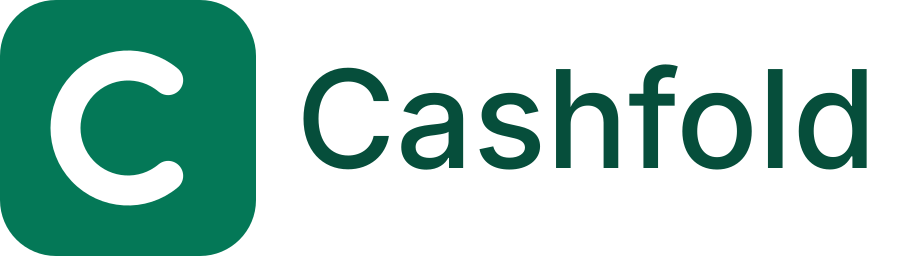
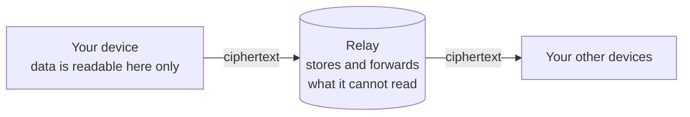

<p align="center">
  <picture>
    <source media="(prefers-color-scheme: dark)" srcset="assets/logo/logo-dark.svg" />
    
  </picture>
</p>

<h3 align="center">Personal finance that only you can read.</h3>

<p align="center">
  <a href="https://github.com/cashfold/cashfold/releases/latest"><strong>Download</strong></a>
  ·
  <a href="docs/self-hosting.md">Run your own relay</a>
  ·
  <a href="docs/README.md">Documentation</a>
  ·
  <a href="https://github.com/cashfold/cashfold/issues/new?template=bug_report.yml">Report a bug</a>
  ·
  <a href="SUPPORT.md">Get help</a>
</p>

<p align="center">
  <a href="https://github.com/cashfold/cashfold/actions/workflows/ci.yml"></a>
  <a href="https://github.com/cashfold/cashfold/releases/latest"></a>
  <a href="LICENSE"></a>
</p>

Cashfold is a personal finance app that keeps your accounts, budgets and transactions encrypted on
your own devices. Sync and sharing go through a relay server that stores ciphertext it cannot read.
It runs in the browser and as an app for Windows, macOS and Linux, works offline, and keeps every
amount as an exact integer, never as floating point.

There is no analytics, no third-party script and no bank connection, by design: a bank feed would
need your transactions to be readable on someone's server, and Cashfold never lets that happen.

> [!WARNING]
> **Pre-1.0.** Screens and data formats can still change between 0.x releases. Read the
> [changelog](CHANGELOG.md) before you upgrade, and keep an encrypted backup of anything you care
> about. If you lose your password and Secret Key and have no Recovery Key, nobody can recover your
> data, including the maintainers.

## Contents

- [Why Cashfold](#why-cashfold)
- [Is it for you?](#is-it-for-you)
- [Features](#features)
- [How your data is protected](#how-your-data-is-protected)
- [Get Cashfold](#get-cashfold) (desktop app, web app and your own relay, from source)
- [Languages](#languages)
- [Documentation](#documentation)
- [Help and security](#help-and-security)
- [Development](#development)
- [Contributing](#contributing)
- [License](#license)

## Why Cashfold

- **Only you can read your data.** Everything is encrypted on your device before it leaves it. The
  relay never receives an amount, a name, a note, a date or a key.
- **It works without a server.** Without a relay, everything stays on one device. A relay only keeps
  your devices in step, and you can run your own in a few minutes.
- **The numbers are exact.** Money is a whole number of minor units (cents, pence, kopiykas), with
  one rounding rule, so a balance never drifts.
- **You can check what you run.** The source is AGPL-3.0, the web build is reproducible, and every
  release has checksums and a build attestation.

## Is it for you?

Cashfold suits you if you want to track your money without uploading your financial records to a
company's cloud, and you are happy to look after a Secret Key and an Emergency Kit.

It may not suit you yet if you need transactions to arrive from your bank on their own (you import
CSV files instead), or if you need a 1.0 that will not change between releases.

## Features

| Area                     | What you get                                                                                                                                                            |
| ------------------------ | ----------------------------------------------------------------------------------------------------------------------------------------------------------------------- |
| **Ledger**               | Accounts, categories, payees, tags, transactions and transfers, in any currency, with exchange rates. Files attached to transactions. CSV import and export.            |
| **Planning**             | Envelope budgets with a rollover policy, recurring schedules with projected balances, and savings goals.                                                                |
| **Sync and sharing**     | Several devices in step. Share a Fold (a ledger such as _Personal_ or _Family_) as owner, editor or viewer. Removing someone rotates the keys.                          |
| **Privacy by design**    | A password and a Secret Key that never leave your devices. Argon2id stretches the password, sign-in uses SRP, and data at rest is an encrypted SQLite database.         |
| **Recovery you control** | An Emergency Kit, an optional Recovery Key, encrypted backups, and optional quick unlock with your device's biometrics or PIN.                                          |
| **Desktop**              | Locks when the computer locks or sleeps, a tray or menu-bar icon, native reminders, and opens CSV files, backups and `cashfold://` links. Updates only when you say so. |
| **Languages**            | English, Ukrainian and Polish. The text follows your system, and you can change it in Settings.                                                                         |

## How your data is protected



- The relay keeps ciphertext and a little routing data. [The list of what it can learn](docs/privacy.md)
  is exact.
- Your password and Secret Key are never sent to the relay.
- Removing a person from a shared Fold rotates its keys. What they already saw cannot be taken back.

The design, step by step, is in [docs/ARCHITECTURE.md](docs/ARCHITECTURE.md). To report a
vulnerability, see [SECURITY.md](SECURITY.md).

## Get Cashfold

**Start here.** Download the desktop app below, or run the web app from source (see
[Try it from source](#try-it-from-source)). Then:

1. Create an account with a password. Cashfold gives you a Secret Key.
2. Download or print your **Emergency Kit** and keep it somewhere safe. It holds the Secret Key.
3. Add an account and your first transactions, or import a CSV file.

### Desktop app

Download the installer for your system from the
[releases page](https://github.com/cashfold/cashfold/releases/latest).

| System                       | File                                                                         |
| ---------------------------- | ---------------------------------------------------------------------------- |
| Windows 10 and later, 64-bit | `Cashfold-<version>-win-x64.exe`                                             |
| macOS 12 and later           | `Cashfold-<version>-mac-arm64.dmg` (Apple silicon) or `-mac-x64.dmg` (Intel) |
| Linux, 64-bit                | `Cashfold-<version>-linux-x64.AppImage`, `.deb` or `.rpm`                    |

It is the same app as in the browser, in its own window. The same account works on both, and your
data stays in your computer's application-data folder. See [docs/desktop.md](docs/desktop.md) for
details.

**Unsigned builds.** Until the installers are code-signed, the release is marked **UNSIGNED BUILD**
and your system warns you the first time you open the app. Check the download first (below), then:

- **macOS:** open **System Settings → Privacy & Security**, scroll to the message about Cashfold
  and choose **Open Anyway**. On older versions of macOS, Control-click the app and choose
  **Open**.
- **Windows:** in the SmartScreen window choose **More info**, then **Run anyway**.
- **Linux:** make the AppImage executable (`chmod +x`) and run it. On Ubuntu 23.10 and later see
  [Troubleshooting](docs/desktop.md#troubleshooting).

**Check what you downloaded.** Every release lists a checksum for each file and a build
attestation:

```sh
sha256sum -c SHA256SUMS --ignore-missing
gh attestation verify <file> --repo cashfold/cashfold
```

### Web app and your own relay

The web app is a static site, and the relay is a small service you run with Docker. You need a
machine with Docker and Docker Compose, a domain name, and a reverse proxy that terminates TLS.

```sh
cp deploy/example.env deploy/.env      # then set SERVER_SECRET, POSTGRES_PASSWORD, PUBLIC_URL, ALLOWED_ORIGINS
docker compose -f deploy/compose.yml --env-file deploy/.env up -d --build
curl http://127.0.0.1:8080/healthz     # the relay answers on the local port
```

[Running your own relay](docs/self-hosting.md) has every step, including the reverse proxy and
publishing the web app. Read [what the service can see](docs/privacy.md) before you choose a relay.

### Try it from source

You need [Node.js](https://nodejs.org/) (the version in [`.nvmrc`](.nvmrc)) and
[pnpm](https://pnpm.io/) 10 (`corepack enable` picks the version pinned in `package.json`).

```sh
git clone https://github.com/cashfold/cashfold.git
cd cashfold
pnpm install
pnpm --filter @cashfold/web dev      # open http://localhost:3000
```

Without a relay, the app keeps everything on this one device.

## Languages

Cashfold is available in **English**, **Українська** (Ukrainian) and **Polski** (Polish). It follows
your browser's or system's language, and you can choose another while creating your account and
change it later in Settings → Appearance. The choice stays on your device. How the translations
work, and how to add a language, is in [docs/i18n.md](docs/i18n.md).

## Documentation

Start at the [documentation index](docs/README.md). The most useful pages:

| If you want to…                        | Read                                         |
| -------------------------------------- | -------------------------------------------- |
| run a relay for your devices           | [docs/self-hosting.md](docs/self-hosting.md) |
| know what the service can see          | [docs/privacy.md](docs/privacy.md)           |
| understand the design                  | [docs/ARCHITECTURE.md](docs/ARCHITECTURE.md) |
| see how sync works                     | [docs/sync.md](docs/sync.md)                 |
| build, test or release the desktop app | [docs/desktop.md](docs/desktop.md)           |

## Help and security

| You have…                 | Go to                                                                                                    |
| ------------------------- | -------------------------------------------------------------------------------------------------------- |
| a question                | [SUPPORT.md](SUPPORT.md), which lists where answers are                                                  |
| a bug                     | the [bug report form](https://github.com/cashfold/cashfold/issues/new?template=bug_report.yml)           |
| an idea                   | the [feature request form](https://github.com/cashfold/cashfold/issues/new?template=feature_request.yml) |
| a vulnerability to report | [SECURITY.md](SECURITY.md), not a public issue                                                           |

Never paste your password, Secret Key, Recovery Key or Emergency Kit into an issue.

## Development

```sh
pnpm install                       # also activates the commit-message hook
pnpm --filter @cashfold/web dev    # the web app on http://localhost:3000
pnpm --filter @cashfold/desktop dev    # the desktop app, from source
pnpm verify                        # type-check, lint and unit tests; run before every push
```

Run the smallest check that proves your change:

```sh
pnpm exec vitest run path/to/file.test.ts      # one unit test file
pnpm --filter @cashfold/web test:browser       # OPFS, workers and WASM in a real browser
pnpm exec playwright test -c e2e/playwright.config.ts e2e/<file>.spec.ts --project=chromium
```

| Path                | What it is                                                             |
| ------------------- | ---------------------------------------------------------------------- |
| `apps/web`          | The web client: Next.js static export, the worker and storage adapters |
| `apps/server`       | The relay: NestJS with PostgreSQL (or in memory for trials)            |
| `apps/desktop`      | The Electron shell around the web export                               |
| `packages/core`     | The domain and application layers, independent of any framework        |
| `packages/crypto`   | All cryptography, behind narrow interfaces                             |
| `packages/protocol` | Wire types and schemas shared by client and server                     |
| `packages/platform` | The contract between the desktop shell and the page                    |
| `docs/`             | Architecture, protocol, operations and decisions                       |

## Contributing

Read [CONTRIBUTING.md](CONTRIBUTING.md) before you open a pull request: it covers the workflow,
tests, commit titles, reviews, and how a change becomes a release. Everyone taking part is expected
to follow the [Code of Conduct](CODE_OF_CONDUCT.md).

## License

Cashfold is licensed under the [GNU Affero General Public License v3.0](LICENSE). Third-party
components and their licenses are listed in [THIRD_PARTY_NOTICES.md](THIRD_PARTY_NOTICES.md).
